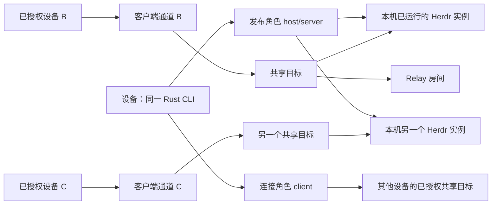

# Herdr Relay 领域术语

Current release: v0.2.1, published 2026-10-10. Implementation, CI, public distribution, service upgrades and actual runtime coverage are recorded in the [release acceptance](docs/validation/2026-10-10-release-0.2.1.md). Earlier candidate records remain historical evidence.

需求和未决事项见 [REQUIREMENTS.md](REQUIREMENTS.md)。这些定义用于避免混淆，不承诺尚未确认的数量、数据结构或协议字段。

| 术语 | 含义 | 需要区分的对象 |
|---|---|---|
| Herdr 运行实例 | 目标电脑上当前运行、可供原生 client 接入的 Herdr server 实例 | 进程重启结束旧运行实例；不是持久共享配置、Relay 房间或 CLI 进程 |
| Herdr session | 用于选择和定位 Herdr 的逻辑会话；具体路径规则以兼容版本为准 | 同一已配置 session 可在进程重启后恢复共享，运行实例和通道会更新 |
| 设备（Device） | 安装同一 Rust CLI、可发布本机实例或访问远端实例的电脑；一个本机用户配置持有一份身份 | 没有固定的客户端或服务端类别；不同 OS 用户不共享私钥，同一电脑的不同配置也可以具有独立身份 |
| 主机设备（Host device） | 相对于某个共享目标，运行并发布该 Herdr 实例的设备 | 角色跟随访问关系，同一设备也可以作为另一目标的客户端 |
| 客户端设备（Client device） | 相对于某个共享目标，运行原生 client 并访问它的设备 | 一个实例同时只接受一个活动 Relay 客户端；同一设备也可以发布本机实例 |
| 设备身份（Device identity） | 配对和授权验证所使用的持久端点身份，属于本机用户配置 | 不等于设备名称、房间 ID 或 Relay 接入凭据，也不随一次 CLI 进程退出而改变 |
| 主机端（host/server） | Rust 程序的发布职责：接入指定实例、验证访问、处理加密与中继连接 | 用户所说 CLI 的 server 角色；区别于 Herdr server 和 Cloudflare Relay |
| 连接端（connect） | Rust 程序的客户端职责：连接中继、验证主机、提供本地 IPC、启动原生 client | 研究中的 `attach` 是旧候选命令名，未另设一种产品角色 |
| 共享目标（Shared target） | 本机用户保存的逻辑 session 发布配置；客户端通过设备和实例选择它 | 每设备可有多个目标，每目标同时只允许一个活动客户端；同 session 重启后自动恢复，显式停用仍保持停用 |
| Relay | 云端中继系统，由 Worker 入口和 Durable Object 组成 | 不处理 Herdr 命令，不承担 Herdr 内部权限管理 |
| 默认托管 Relay | 产品默认提供、公开免费、免注册且有资源配额的共享中继服务 | 无需邀请码；设备身份与配对决定访问资格，共享服务不赋予跨用户访问权 |
| 自建 Relay | 用户使用项目源码自行部署并选择使用的中继服务 | 使用同一核心协议；切换服务后重新配对，不沿用另一服务下的授权 |
| Relay 房间（Room） | DO 中用于组织共享目标相关连接的逻辑路由单元 | 房间 ID 用于路由，不承担身份认证 |
| Relay 接入凭据 | 允许端点进入云端路由的凭据 | 不足以单独获得主机上的 Herdr 访问权 |
| 主机授权（Device grant） | 发布方授予另一设备访问自己当前及未来所有已共享实例的权限 | 有方向，A 授权 B 不意味着 B 授权 A；与云端接入资格分开 |
| 配对（Pairing） | 发布方生成一次性配对串，另一设备导入后验证身份并获得单向设备授权的流程 | 发布方后台服务须在线，无需人工二次确认，Herdr 可离线；配对不自动建立反向授权 |
| 一次性配对串（Pairing invitation） | 发布方签发、可兑换一次设备授权的临时凭据 | 使用次数和有效期受限；不同于已保存设备身份、长期授权或房间 ID |
| 后台用户服务（User service） | 用户可安装、启动、停止和查询状态的本机 CLI 常驻运行方式 | 另有前台模式；停止服务结束管理的通道，但不终止 Herdr 或 agent |
| 加密通道（Channel） | 某客户端与共享目标之间经验证、承载 Herdr 数据的通信通道 | 同一目标同时最多一个活动操作通道；重连建立新通道，不能抢占有效连接 |
| 独占占用 | 一个共享实例同时只供一个 Relay 客户端连接操作的约束 | 授权多台设备不等于允许同时操作；后来连接报忙，不抢占；不同实例可并行 |
| 连接代次（Generation） | 区分替换前后连接、防止失效连接继续参与路由的标记 | 不等于 Herdr 实例身份或 Relay 协议版本 |
| 原生客户端通道 | Herdr native client 使用的 IPC 通道，默认对应 `herdr-client.sock` | `herdr.sock` 是另一类 JSON API 通道 |
| 控制消息 | Relay 协议所需的路由、角色、心跳、错误等信息 | 与加密的 Herdr 数据分开，不写入 Herdr socket |
| 重新 attach | 网络恢复或目标重新可用后，自动用新通道连接目标 Herdr 并同步现有状态 | 不缓存或重放断线期间输入，不重放未知结果的按键 |
| 撤销设备 | 发布方取消某设备对自己所有共享实例的访问，结束相应连接并拒绝后续接入 | 不撤销反向独立授权，也不影响其他获准设备 |
| 停止共享 | 显式停止目标的 Relay 访问 | 不意味着停止 Herdr server 或其 agent |
| Herdr 薄插件 | 后续版本提供安装、管理和连接入口，调用独立 Rust 程序的外层集成 | 不在首版交付范围；首版通过 CLI 使用和管理 |

## 当前关系模型

图表达双向角色能力、同设备多实例发布及不同实例并行访问；每个实例同时最多一个活动客户端。授权按设备且有方向，覆盖授权方全部已共享实例。具体进程、持久化和数量上限见[实施方案](docs/implementation-plan.md)，工程默认值不等于公开服务承诺。

工程协议进一步区分 `boot_id`（daemon 启动）、`runtime_id`（目标运行代次）、`channel_id`（单次访问）和 `grant_version`（方向授权版本），定义见[协议字段](protocol/README.md)。身份和配对实现见[ADR-0011](docs/adr/0011-endpoint-tls-and-pairing.md)。一次 attach 对应独立 native socket；同一 tab 的 PTY 尺寸仍由 Herdr 原生活动规则决定。

## 必须保持的区分

- 设备身份、共享目标身份、Herdr 实例身份、通道身份分别讨论，不能全部叫作 session。
- 网络断开、Rust 程序重启、Herdr 实例重启具有不同后果，不能统一称为“重连后恢复”。
- 受信任设备、能够进入 Relay 的设备、获准访问某实例的设备不能直接视为同一集合。
- “原生界面”说明用户使用 Herdr client，不表示已集成 Herdr 的 Machines 侧栏。
- 默认 Relay 服务多个用户，需要跨用户隔离；单个共享实例只允许一个活动客户端，需要独占占用管理。多台设备可获授权并先后使用同一实例。
- 设备角色对称，访问授权有方向；A 授权 B 与 B 授权 A 是两条独立授权。
- 新实例被本机用户明确共享后，现有获准设备自动获得访问资格；设备授权不会自动发布未共享的实例。
- 同一已配置 session 的进程重启可自动恢复原共享；设备授权与共享配置持久存在，运行实例和客户端通道按新生命周期建立。
- “用户”描述使用者；首版没有与之必然一一对应的云端账号实体。主机本地管理授权设备；通过云端设备准入不等于获得主机访问授权。
- 首版产品是可用 CLI 与 Cloudflare Relay；“插件”仅指后续集成，不应据此为首版引入插件安装和终端启动包装。

## Interactive presentation terminology

- **Host name**: the human-readable hostname carried with a pairing invitation. It is a display label, not a device identity or an authorization key.
- **Host alias**: a locally saved, unique display name for a paired host. Changing it does not change the peer identity, trust scope, or grant.
- **Pairing link**: a copyable representation of a one-time pairing invitation and its host name. The link token preserves the existing invitation semantics; it does not replace the saved device grant.
- **Server autostart**: automatic activation of the Relay user service under the selected login or Linux linger policy. It does not create a Herdr session.

The preferred user workflow and its lifecycle boundaries are recorded in [ADR-0014](docs/adr/0014-interactive-cli-and-server-lifecycle.md).
