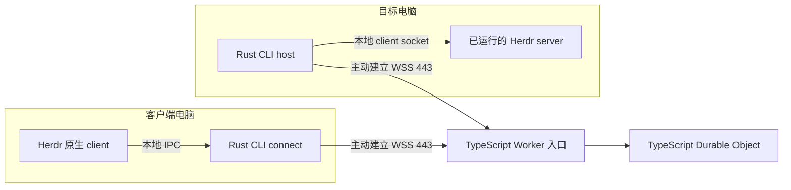

# Herdr Relay 设计

> 2026-10-09 需求访谈更新：**第一版交付可用 Rust CLI 与 TypeScript Cloudflare Worker/DO Relay，插件留到后续。** 默认公开免费、免注册并设资源配额，同时支持开源自建；两端支持 macOS（Apple Silicon、Intel）和 Linux（x86_64、arm64）。本轮确认与工程待决项见 [REQUIREMENTS.md](REQUIREMENTS.md)，以其中已确认的要求为准。

> 2026-10-10 修正：设备通过同一 CLI 既可发布也可连接；一台设备可同时发布多个实例，连接时选择设备和实例；每个实例同时最多一个活动 Relay 客户端。后来的连接返回 TARGET_BUSY，不抢占；多台设备可获授权并先后使用，不同实例可并行。见 [ADR-0012](docs/adr/0012-single-active-client-per-target.md)。

> 授权范围已更新：按设备授权访问发布方当前与以后新增的所有已共享实例；两个方向分别授权。未共享实例仍不可访问，撤销设备应结束它对本机所有共享实例的连接。

> 使用流程已更新：发布方生成一次性配对串，另一设备导入即可授权，无需二次确认；兑换时发布方后台服务必须在线，Herdr 可以离线。CLI 提供后台用户服务安装、启动、停止、状态查询，并保留前台模式。

> 恢复规则已更新：同一已配置 session 重启后自动恢复共享并沿用有效设备授权；网络中断后自动重新 attach，使用新通道，断线期间不缓存或重放输入。CLI 仍不负责启动 Herdr。

更新日期：2026-10-10。状态：核心产品范围和语言选型已确认；已有 Rust/TypeScript 实现、受控 Cloudflare 部署及四平台候选包。完整 GUI、全链路资源及公开发布验收仍未完成，当前证据见[候选记录](docs/validation/2026-10-10-candidates.md)。

后续证据与实现见[本机兼容性报告](docs/herdr-compatibility.md)、[实施方案](docs/implementation-plan.md)、[协议](protocol/README.md)。下面保留总体设计及历史候选方案；实际 CLI 和工程默认值以实施方案、README 与候选记录为准，不能将历史建议视为当前实现或发布承诺。

## 已确认的方向

- **桌面两端的 CLI 使用 Rust**，同一个可执行文件提供发布和连接职责；当前入口是 `serve --relay` 和 `connect`。
- **Cloudflare Worker 与 Durable Object 均使用 TypeScript**，直接使用 Workers 平台接口，本版不引入 Rust/Wasm 云端实现。
- 第一版为 Herdr 专用 CLI 与 Cloudflare Relay，通过公网中继访问用户已运行的 Herdr，并保留原生客户端界面；薄插件留到后续。**MCP 不进入调用链路。**

Rust CLI 与 TS 云端的语言分工由用户于 2026-10-09 明确确认。下文 `host` 表示历史设计中的发布职责，不是现有子命令；功能是否实现或通过验证应查阅对应记录。

## 连接路径与职责



图表示一次访问；设备可交换角色，每台设备可发布多个实例，每个实例同时只有一个活动 Relay 客户端。网络箭头表示连接发起方向，建立后数据双向流动。两端均主动连接公网 Relay，无需家庭网络开放入站端口、SSH、浏览器界面或 P2P 打洞。端到端加密覆盖两个 Rust 端点之间的 Herdr 数据，Worker 和 DO 只转发密文。

| 模块 | 实现方式 | 职责 |
|---|---|---|
| Herdr 薄插件（后续版本） | manifest 与必要的系统启动包装 | 通过 Rust CLI 提供管理和连接入口；不属于首版交付 |
| CLI `host` | Rust | 绑定指定实例、连接既有 client socket、验证客户端身份与授权、加解密、管理网络连接和本机服务生命周期 |
| CLI `connect` | Rust | 连接 Relay、验证主机身份、加解密、提供本地 IPC、按远程语义启动原生 Herdr client |
| Worker 入口 | TypeScript | 处理 WebSocket upgrade、校验 Relay 接入凭据、将连接路由到相应 DO |
| Relay 房间 | TypeScript Durable Object | 校验角色与代次、配对连接、有界转发、限流、关闭失效连接、恢复休眠后的路由状态 |
| Herdr | 现有程序 | 原生界面、pane、agent、执行权限和会话状态 |

Rust 用于本机程序，便于原生二进制分发，以及处理 socket、终端和进程生命周期。开发期需要 Rust 工具链；最终用户不需要安装 Rust、Node.js 或 npm。各系统和架构仍需分别构建、发布和验证。

TypeScript 用于云端，减少 Workers 平台接口与构建工具之间的适配。两端通过协议协作，不通过共享运行时或把 Rust CLI 编译后上传 Worker。两种语言的分工不要求云端了解 Herdr 内部协议。

## Rust 与 TypeScript 之间的协议

**只维护一份独立于语言的 Relay 协议说明。** 建议使用版本化控制消息描述连接角色、目标、连接 ID、代次、心跳和错误；Herdr 数据以有序二进制消息承载。具体字段、编码及上限在协议实现前确定。

- Rust 将 Herdr 字节流分块、加密后发往 Relay；接收端验证、解密并按序写回 IPC。心跳和路由控制消息不得写入 Herdr socket。
- TS 只解析 Relay 所需的控制信息与外层封装，不解密终端数据，不实现 Herdr 的 JSON API、渲染协议或任务编排。
- Rust 与 TS 使用同一组协议样例验证版本协商、字段约束、错误和二进制透传，不能依赖两套语言类型恰好一致。
- Relay 协议版本与 Herdr 兼容版本分别管理。不兼容时明确失败；Herdr 本地适配的版本问题由 Rust 端报告。
- 两端和 Relay 都限制消息尺寸、待发送数据及连接数量。`send()` 不代表对端已消费数据，需要应用层窗口或等效的有界流控；慢端超限时关闭通道并报告原因。

首版支持每台设备同时发布多个 Herdr 实例，客户端选择设备和实例连接；每个实例可授权多台设备，但同时只接受一个活动 Relay 客户端。同一 Rust CLI 可承担发布或连接角色。DO 按逻辑共享目标的稳定标识组织房间，不依赖某次 Herdr 进程的生命周期；同一实例只允许一个待建立或活动的 attach 占用，主机与 Room DO 都执行独占检查；单次连接使用独立 ID 与代次，后来的连接报忙，重连不能替换有效连接。只有旧通道停止且旧代次失效后才释放占用；重复 session 配置或别名不能绕过限制。不同共享目标分别管理，停止一个实例的共享不影响其他目标。房间标识不承担身份认证。主机离线时明确返回离线，不缓存待执行的键盘输入。

本机探针已验证两个独立 native protocol 端点的接入、输入、surface 更新和断开隔离。每次远程 attach 因而采用独立的主机 client socket 与加密通道；同一 tab 的 PTY 尺寸沿用 Herdr 活动/焦点规则，不承诺每客户端独立尺寸。这些上游能力不改变产品的独占要求；多目标并行和竞争报忙已有候选记录，实际 GUI 与完整故障组合仍需补全，见 [ADR-0010](docs/adr/0010-independent-native-client-channels.md) 与 [ADR-0012](docs/adr/0012-single-active-client-per-target.md)。

## Herdr 适配与生命周期

源码核对基线为 Herdr 0.9.3，提交 `7b116c05bfda646af39d2524c54e70c751f57ee8`。以下内部入口需要随 Herdr 升级重新验证。

**主机只连接已运行的指定实例。** Rust `host` 按绑定 session 的路径规则连接 native client socket；失败即报告离线。默认 `herdr.sock` 是 JSON API 通道，原生客户端使用 `herdr-client.sock`。首版避免调用会自动启动缺失 server 的 `remote-client-bridge`，也不默默回退到默认 session。[路径规则](https://github.com/herdrdev/herdr/blob/7b116c05bfda646af39d2524c54e70c751f57ee8/src/server/socket_paths.rs#L4-L57)、[bridge 行为](https://github.com/herdrdev/herdr/blob/7b116c05bfda646af39d2524c54e70c751f57ee8/src/remote/host.rs#L6-L63)

**客户端保留官方远程启动语义。** Rust `connect` 创建本地 socket 并启动 `herdr client`，设置 client socket、remote keybindings 和重连提示，清除冲突的 socket/session 环境。桥接出的本地 socket 不代表两台电脑共享文件系统。[官方启动实现](https://github.com/herdrdev/herdr/blob/7b116c05bfda646af39d2524c54e70c751f57ee8/src/remote/attach.rs#L3324-L3342)

**首版从终端运行 CLI 并启动原生 Herdr client。** 具体终端能力需随平台验证。后续插件集成仍受 0.9.3 的约束：插件通过外部命令扩展，无法注册新的机器 transport；普通 action 捕获输出，pane 内嵌套 Herdr 默认被禁止。插件拉起外部终端和原生 Machines 侧栏集成都属于后续工作。[插件 manifest](https://github.com/herdrdev/herdr/blob/7b116c05bfda646af39d2524c54e70c751f57ee8/src/app/api/plugins/manifest.rs#L11-L34)、[连接端点类型](https://github.com/herdrdev/herdr/blob/7b116c05bfda646af39d2524c54e70c751f57ee8/src/client/endpoint.rs#L73-L89)

首版提供后台用户服务的安装、启动、停止和状态命令，同时保留前台运行。二进制安装在持久路径，密钥、配置和状态保存在用户专用目录。工程方案采用 macOS LaunchAgent / Linux systemd user，并明确登录生命周期限制；无 systemd 可使用前台模式。具体最低系统与安装行为仍待实测。关闭终端不应停止已安装并运行的用户服务；客户端退出、网络中断和服务停止均不终止目标 Herdr 与 agent。停用某个共享目标只结束其 Relay 通道。后续插件的 startup 是一次性 hook，仍不能代替用户服务管理，也不能把持久数据放入会被插件更新替换的 checkout。

网络中断后客户端自动建立新通道，重新 attach 并同步现有状态，断线期间不缓存或重放输入。共享配置绑定用户明确选定的逻辑 session；同一已配置 session 的 Herdr 重启后自动恢复共享，沿用有效设备授权，无需本机再次确认。旧运行实例的连接全部失效，新运行实例使用新通道和新连接代次；未配置的 session 不自动发布，也不作为连接失败的回退。显式停止共享或撤销设备后，自动恢复不得绕过这些状态。CLI 仍只连接已运行的 Herdr，不负责启动它；Rust 程序重启的具体恢复机制待设计。

TS DO 使用接受入站 WebSocket 的 Hibernation API；连接身份、角色和代次须能从 attachment 与必要的持久状态恢复，不能仅保存在内存变量中。休眠保留连接不等于保证网络永不断线。[Cloudflare WebSocket 指南](https://developers.cloudflare.com/durable-objects/best-practices/websockets/)

## 配对、加密与授权

已确认的首版流程是发布方生成一次性配对串，另一端导入并完成身份验证与兑换后保存设备授权，无需发布方再次确认。兑换时发布方 Relay 后台服务须在线，Herdr 可以离线；发布方服务离线时不能宣告配对成功。该授权覆盖发布方当前与未来全部已共享实例，两个方向分别授予。配对串需要限制使用次数和有效期，并将兑换结果绑定到设备身份。Rust 端自动生成并保管私钥，用户无需手工维护 SSH 密钥。当前实现使用 rustls TLS 1.3、设备公钥固定与原子配对事务；验证证据和边界见 [ADR-0011](docs/adr/0011-endpoint-tls-and-pairing.md)。

Relay 接入凭据只决定能否进入云端连接路由；访问 Herdr 的授权由发布方验证。两层都要校验连接角色和有效期。A 撤销 B 时，关闭 B 对 A 全部共享目标的活动通道并拒绝后续接入，云端作废相应作用域内的凭据和连接；B 曾独立授予 A 的反向权限以及其他设备的连接保持有效。当前实现先本地持久化并关闭受影响通道，再同步云端，具体证据见[撤销记录](docs/validation/2026-10-10-revocation.md)。不能把普通 token 配对等同于端到端身份验证。

Worker/DO 不持有设备私钥或会话解密密钥。云端仍可见路由标识、连接时间和消息大小等元数据。首版设备授权提供发布方全部已共享实例的操作权限；只读、单 pane 和命令级权限需要 Herdr 或端点支持，不由密文 Relay 承诺。默认服务公开免费且有资源配额，工程准入、限流与配额已有实现及[受控记录](docs/validation/2026-10-10-admission.md)，生产设置仍待 #19；免费不意味着无限资源。

## 代码组织与实施顺序

当前代码组织如下；插件留到后续版本：

```text
src/                  Rust CLI：serve、connect、配对及本机管理
tests/                必要的 Rust 行为与回归测试
relay/                TypeScript Worker、Durable Object 与必要测试
scripts/              构建安装入口及独立兼容性探针
protocol/             协议说明、版本和跨语言验证样例
docs/                 安装、运维及 Herdr 兼容性说明
```

1. **P0 验证本机适配。** 在已通过的协议探针基础上，用 Rust 完成既有 socket 接入和真实 native client 启动；验证多实例、单实例独占、输入与 resize、session 重启及退出行为。
2. **P1 完成设备信任与协议。** 实现配对事务、端到端 TLS、公钥固定、主机授权、密钥存储、撤销及跨语言协议样例，通过安全负例。
3. **P2 接入 TS Relay。** 在受控 Cloudflare 环境验证已认证且端到端加密的双端 WSS、有界流控、DO 休眠、配额与断线重新 attach。
4. **P3–P4 完成首版交付。** 完成四平台二进制、用户服务、CLI 与自建说明；验证升级、跨平台连接、默认服务运营配置和限额，再发布。完整退出条件见[实施方案](docs/implementation-plan.md)，薄插件留到后续版本。

验收覆盖输入、resize、Unicode、粘贴和图像能力；多实例目标选择正确；同实例独占与忙碌拒绝、不同实例并行；不兼容版本清晰失败；持续输出与慢端流控；空闲唤醒；网络中断后自动恢复且无输入重放；已配置 session 重启自动恢复共享并沿用有效设备授权；显式停用和设备撤销不被自动恢复绕过；客户端退出后远端 Herdr 和 agent 继续运行。完整产品验收仍待完成；已测范围、实际环境和未完成项集中记录于[候选报告](docs/validation/2026-10-10-candidates.md)。

## 参考项目与范围

Pairfob 提供薄插件与独立 daemon 包装参考；Paseo 提供控制/数据连接及端点加密参考；Agenvo 提供设备准入、连接代次和后端实例生命周期参考。借鉴各自适合的实现，不合并它们的产品层，也不引入 MCP。

第一版建议只支持 Cloudflare Relay，不同时实现 VPS 后端、OAuth、P2P、通用 runtime adapter 或任务编排。Cloudflare Tunnel 与全 Rust Worker 保留为历史调研选项，不属于本次选定的实现路径。

前期证据：[原始方案调研](RESEARCH.md)。原稿还引用 `../work/herdr-relay-plugin-feasibility.md`、`../work/paseo-relay-server-research.md` 和 `../work/agenvo-research.md`；这些文件不在当前仓库中，不作为已读取的补充证据。实现方向以本文及 REQUIREMENTS.md 中后续已确认的要求为准。
