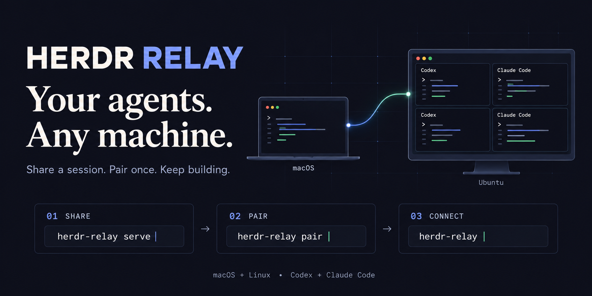
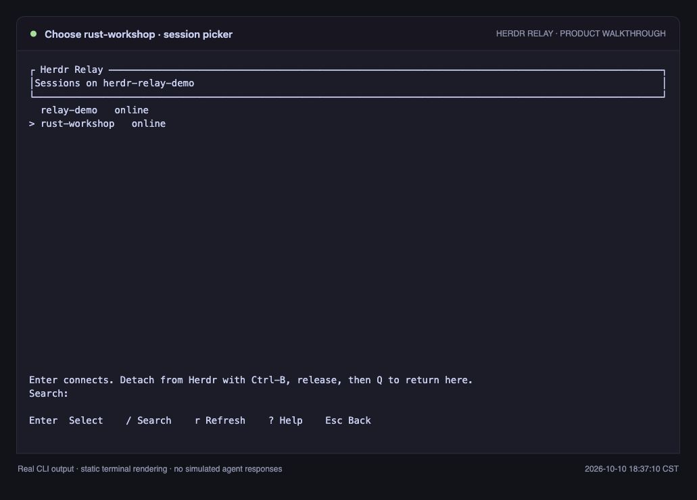
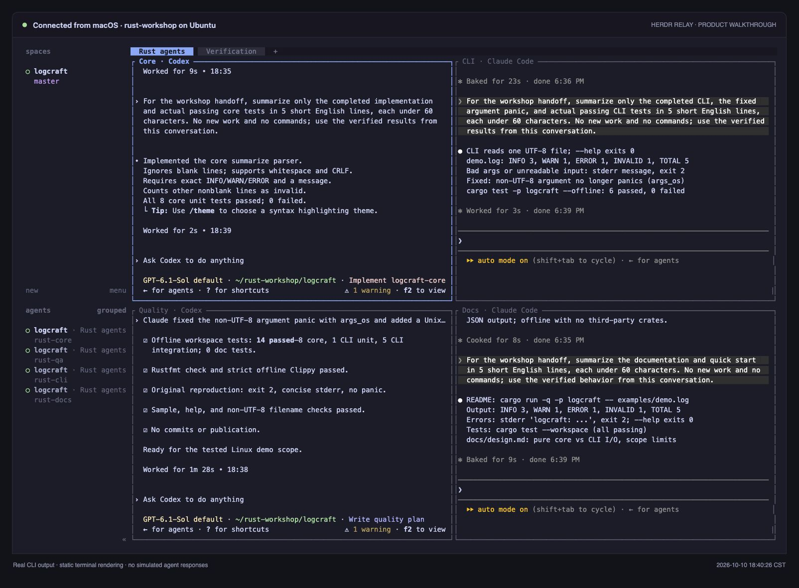

# Herdr Relay

[English](README.md) · [简体中文](README.zh-CN.md)



Access your Herdr sessions from another computer through the native terminal
interface. Herdr Relay supports macOS and Linux, encrypted pairing, multiple
shared sessions, and background sharing with automatic reconnect.

## Install

Install [Herdr latest](https://github.com/herdrdev/herdr/releases/latest) on both
computers. Herdr Relay supports compatible native Herdr clients without pinning
a release number; 0.9.3 and 0.9.4 have been tested together. See
[Herdr compatibility](docs/herdr-compatibility.md).

Get Herdr Relay from the
[GitHub Releases](https://github.com/hackerchai/herdr-relay/releases/latest) (or the faster
[download site](docs/install.md#download-site)) or install it with Rust 1.99 or newer:

```sh
cargo install herdr-relay --locked
```

## Quick start

On the computer you want to access, start `herdr`, then detach with **Ctrl-B,
release, Q**. Start sharing:

```sh
herdr-relay serve
```

Select sessions with **Space**, press **Enter**, and copy the pairing link.
The background service is installed and started automatically.

On the other computer:

```sh
herdr-relay pair
```

Paste the link and choose a host and session. For later connections, just run
`herdr-relay`. The default hosted Relay requires no account or Cloudflare setup.

When both computers share a LAN or tailnet, Herdr Relay connects directly with
the same end-to-end encryption and falls back to the relay otherwise; the host
menu shows which path each host uses. Allow TCP port 47120 on the host's
firewall to use it. On macOS, the app running `herdr-relay` may need Local
Network permission.

## Configuration

Herdr Relay needs no configuration. To change a default permanently, such as a
self-hosted Relay's origin or the Herdr executable, save it in `config.toml`
(`~/.config/herdr-relay/config.toml` by default):

```sh
herdr-relay config set origin https://relay.example.com
herdr-relay config set token     # a self-hosted Relay's access token, entered hidden
herdr-relay config show
```

Flags and environment variables still override the file. The hosted Relay never
uses a token. See the [configuration guide](docs/configuration.md) for every
setting.

## In action

Choose a shared session by name, then connect to its agent workspace.





*Terminal views rendered from real demo output.*

## Guides

- [First connection: English](docs/quickstart.md) · [中文教程](docs/quickstart.zh-CN.md)
- [Installation and background services](docs/install.md)
- [Configuration and `config.toml`](docs/configuration.md)
- [Updates and autostart](docs/quickstart.md#background-service-and-upgrades)
- [Sleep protection and MacBook lid-close limits](docs/sleep-protection.md)
- [Host your own Relay](docs/self-hosting.md)
- [Relay development](relay/README.md) · [Protocol](protocol/README.md)

## License

[MIT](LICENSE). Binary releases and the [crate](https://crates.io/crates/herdr-relay)
are public, along with this source repository.
