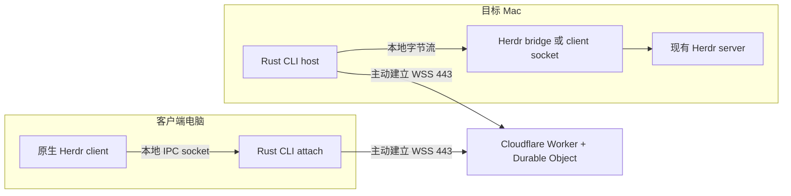

**Herdr 原生客户端经公网中继连接：源码与现成方案调研**

> 2026-10-09 更新：用户已确认 Rust CLI + TypeScript Cloudflare Worker/DO，第一版交付可用 CLI 和 Cloudflare Relay，插件后续，MCP 不进入链路。当前需求访谈结论见 [REQUIREMENTS.md](REQUIREMENTS.md)，Herdr 0.9.3 适配约束及验证计划见[设计文档](DESIGN.md)。下文保留 2026-10-01 的调研记录，其中全 Rust Worker、Tunnel 和自动启动 server 的 bridge 等选项不属于当前首版方案。

核对日期：2026-10-01。Herdr 源码基线为 v0.9.1；Pairfob 基线为提交 `2076dd5832c20190d23ce1855431665b279df703`。其余项目核对当日官方文档和 main 源码。只做研究，没有部署、修改现有 Pairfob 配置或进行远程联通实测。来源为项目官方 GitHub、Cloudflare 官方英文文档和作者一手说明。

2026-10-09 的补充研究单独记录于 [Herdr 0.9.3 兼容性报告](docs/herdr-compatibility.md)和[实施方案](docs/implementation-plan.md)：本机协议探针已通过，Cloudflare、rustls 官方文档已核对，云端端到端尚未测试。下文历史结论不代替新报告中的验证范围。

**结论：这个方向可行，最符合要求的形态是两端使用同一个 Rust CLI，Cloudflare Worker + Durable Object 转发加密的 Herdr 原生客户端字节流。** 两端主动建立 WSS 连接，不要求家庭网络开放入站端口，不需要 SSH、浏览器界面或 P2P 打洞。这里的“可行”是官方平台能力与源码支持的架构判断，完整组合尚待原型验证。

需要补全原始设想中的一处：除了目标 Mac 上的 Rust 程序，另一台机器也需要运行客户端适配程序。Herdr v0.9.1 的 native client 连接本地 IPC socket，现有远程启动器使用 SSH；没有可直接填入 WSS 域名的原生客户端入口。适配程序可以隐藏在一个 `attach` 命令里，让用户仍然看到原生 Herdr 界面。[Herdr 客户端连接](https://github.com/herdrdev/herdr/blob/v0.9.1/src/client/mod.rs#L144-L218)、[官方远程说明](https://herdr.dev/docs/persistence-remote/)

Pairfob 提供了直接相关的实现证据：

- **公网中继已经存在。** 它的服务端是 Worker，每个 `daemon_id` 对应一个 Durable Object。手机和电脑都主动接入同一房间。[中继 README](https://github.com/arronKler/pairfob/blob/2076dd5832c20190d23ce1855431665b279df703/workers/pairfob-origin/README.md)
- **中继只路由加密载荷。** `room/fwd.ts` 按 `route_id` 找到另一端并调用 `send()`，不需要理解终端内容。[转发源码](https://github.com/arronKler/pairfob/blob/2076dd5832c20190d23ce1855431665b279df703/workers/pairfob-origin/src/room/fwd.ts)
- **P2P 可关闭。** daemon 可设置 `PAIRFOB_P2P=0`；自建 origin 可设置 `P2P_OPEN=0`；客户端也提供 Relay 选择。origin 开关对新建或重新加载的会话生效，已有直连会话需重连。打洞不是维持中继通信的前提。[配置说明](https://github.com/arronKler/pairfob/blob/2076dd5832c20190d23ce1855431665b279df703/workers/pairfob-origin/README.md)、[传输策略](https://github.com/arronKler/pairfob/blob/2076dd5832c20190d23ce1855431665b279df703/proto/direct-transport.md)
- **可借鉴房间、设备身份、端点加密和休眠恢复。** Pairfob 的 DO 使用 `acceptWebSocket` 与 socket attachment；端点持有会话密钥。[房间源码](https://github.com/arronKler/pairfob/blob/2076dd5832c20190d23ce1855431665b279df703/workers/pairfob-origin/src/room/room.ts)、[安全设计](https://github.com/arronKler/pairfob/blob/2076dd5832c20190d23ce1855431665b279df703/README.md#security)

Pairfob 不能直接充当原生 Herdr 客户端的现成透明隧道。它的 Go daemon 实现配对、RPC 和 Herdr 适配，Herdr adapter 会向 Unix socket 发送 JSON 请求。原生客户端需要另一套 client protocol。新项目应借鉴中继结构，直接运输原生协议，避免把 Pairfob 的 PWA、业务 RPC、文件操作和 WebRTC 整套移植过来。[Pairfob Herdr adapter](https://github.com/arronKler/pairfob/blob/2076dd5832c20190d23ce1855431665b279df703/internal/runtime/herdr.go#L96-L153)、[项目组成](https://github.com/arronKler/pairfob/blob/2076dd5832c20190d23ce1855431665b279df703/README.md#development)

建议的第一版结构如下，箭头说明连接由谁发起，建立后数据双向流动：



Cloudflare 在这里提供应用中继。域名指向 Worker，Durable Object 将同一主机的两端连接配对。两条 WebSocket 对 DO 而言都是接受的入站连接，因此可使用 Hibernation API。空闲时 DO 可休眠并保留连接，恢复时必须从 attachment 或存储重建身份和路由映射。[DO WebSocket 指南](https://developers.cloudflare.com/durable-objects/best-practices/websockets/)、[Hibernation 示例](https://developers.cloudflare.com/durable-objects/examples/websocket-hibernation-server/)

Herdr 已有两个可复用的内部入口，能缩小 Rust 程序的范围：

1. **目标 Mac：`herdr remote-client-bridge`。** 该隐藏命令检查并启动本地 Herdr server，连接原生 client socket，再把它接到标准输入输出。这个函数自身不调用 SSH，Rust host 可以包装其 stdin/stdout；也可以直接连接 client socket。应把日志留在 stderr，保留 stdout 为协议字节流。[主机桥接源码](https://github.com/herdrdev/herdr/blob/v0.9.1/src/remote/host.rs)
2. **客户端电脑：本地 socket + `herdr client`。** 官方远程启动器本来就创建本地转发 socket，然后设置 `HERDR_CLIENT_SOCKET_PATH` 并启动 `herdr client`。自建 CLI 可借用同一机制。[官方启动方式](https://github.com/herdrdev/herdr/blob/v0.9.1/src/remote/attach.rs#L3029-L3058)
3. **保留远程客户端语义。** 不能只替换 socket 路径。官方同时设置 `HERDR_REMOTE_KEYBINDINGS` 和 reattach command，移除 `HERDR_SOCKET_PATH`。远程标识影响握手超时、按键来源、本地 endpoint 列表和部分图形能力。显式 `--session` 也会覆盖 client socket 环境变量，包装器需要处理这些优先级。[握手行为](https://github.com/herdrdev/herdr/blob/v0.9.1/src/client/handshake.rs#L25-L87)、[路径优先级](https://github.com/herdrdev/herdr/blob/v0.9.1/src/server/socket_paths.rs#L4-L47)

默认会话的 `herdr.sock` 用于 JSON API，`herdr-client.sock` 才是原生客户端通道。转发前者不足以保留完整原生界面。以上入口属于内部实现，第一版应固定两端 Herdr 版本和协议版本，升级时重新检查；不能视为官方承诺稳定的网络扩展 API。

期望的使用体验可以是下面这样。`herdr-link` 是建议的项目名和命令设计，当前没有创建这个工具：

```text
# 目标 Mac
herdr-link host --relay wss://relay.example.com --name mac

# 另一台电脑，连接后自动打开本机的原生 Herdr 客户端
herdr-link attach --relay wss://relay.example.com --host mac
```

桌面两端可以是同一个 Rust binary 的两个子命令。云端 Worker 可使用 TypeScript，或借助 `workers-rs` 编译 Rust/Wasm；它需要适配 Workers 的运行环境，不能把使用原生 OS socket 的桌面 CLI 直接上传。[workers-rs](https://github.com/cloudflare/workers-rs)、[Workers 安全模型](https://developers.cloudflare.com/workers/reference/security-model/)

`workers-rs` 官方源码已有 DO 的 WebSocket 接收、消息回调和 attachment API，支持全 Rust 实现的方向；实施时还需核对发布版本并锁定依赖。当前公开托管 Workers 的协议文档仍未提供通用公网入站 TCP，因此这个设计使用 WSS。SDK 中出现入站 TCP handler，不能直接视为账号已可部署公网 TCP 服务。[Rust DO API](https://github.com/cloudflare/workers-rs/blob/b57ba6ef8198c65499c2f92b1845cc2412dd6e8c/worker/src/durable.rs)、[托管 Workers 协议表](https://developers.cloudflare.com/workers/reference/protocols/)

搜索并核对的现成项目如下。它们可以提供组件或实现参考，尚未找到已验证、开箱即用满足整套 Herdr 需求的项目。

| 项目 | 与需求相符的部分 | 还缺什么 |
|---|---|---|
| [wstunnel](https://github.com/erebe/wstunnel) | Rust；WebSocket；正向与反向转发；可与 Cloudflare Tunnel 组合 | Unix 支持在监听侧，目标仍需 TCP；连接 Herdr 需适配。普通 WSS 经 Cloudflare 终止 TLS，设备间加密需要另加 |
| [rathole](https://github.com/rathole-org/rathole) | Rust；内网 agent 主动连公网 relay；TCP/UDP；可选 TLS/Noise | 官方架构需公网 server；业务端口对最终访问者的认证与加密要单独处理；无原生 Herdr 接口 |
| [bore](https://github.com/ekzhang/bore) | Rust；很小的 TCP 反向隧道；适合参考简化实现 | secret 只做认证，业务数据默认明文；需适配 socket，不宜直接用公共实例承载 Herdr 会话 |
| [Stellate Serve](https://stellate.co/blog/stellate-serve) | 已有 CLI 主动通过 WebSocket 连接 DO、把云端请求转回本地的案例 | 文章实现运输 HTTP 请求/响应，提供架构参考，不能直接当作原生 Herdr 中继 |

这里有两处容易看漏：wstunnel 的 Unix 分支仍使用 TCP upstream，因此“支持 Unix socket”不等于能直接拨号 Herdr 的 Unix 后端；rathole 的 TLS/Noise 主要保护 agent 到 relay，不能据此认定访问公开业务端口的人也已被认证。[wstunnel 运行分支](https://github.com/erebe/wstunnel/blob/main/wstunnel/src/lib.rs#L323-L387)、[rathole 传输安全说明](https://github.com/rathole-org/rathole/blob/main/docs/transport.md)、[bore 认证说明](https://github.com/ekzhang/bore#authentication)

另一条可选路线是 **Cloudflare Tunnel + Mac 上的 WebSocket 网关**。Mac 运行 `cloudflared`，把本机 Rust WS 网关或 wstunnel server 映射到域名，另一台电脑通过 WSS 接入。这可省去自写 Worker/DO 路由服务，但 Mac 多一个 cloudflared 进程；若采用 wstunnel，还需 Herdr socket 适配。它符合“公网中转、不使用 SSH、不打洞”的方向，属于尚未联调的组件组合。[Tunnel 官方说明](https://developers.cloudflare.com/tunnel/)、[Cloudflare WebSockets](https://developers.cloudflare.com/network/websockets/)

普通 Tunnel 的 `unix:` ingress 表示 HTTP over Unix，不能直接填入任意 Herdr 二进制 socket。TCP published application 又通常要求客户端使用 cloudflared。若采用 wstunnel，应选择其 WebSocket 模式，官方文档提示 HTTP/2 模式经 Cloudflare 等代理可能遇到缓冲和协议降级问题。[Tunnel 协议表](https://developers.cloudflare.com/cloudflare-one/networks/connectors/cloudflare-tunnel/routing-to-tunnel/protocols/)、[wstunnel HTTP/2 说明](https://github.com/erebe/wstunnel#http2)

第一版应集中验证这些边界：

- **身份与内容加密。** 域名和 room ID 不能代替访问认证。给主机和客户端配对、绑定设备身份；如果要求 Cloudflare 也无法读取命令与画面，应在两端增加应用层加密。WSS 本身只保证每段 TLS 连接。
- **字节流与背压。** 将 socket 字节流切为有序二进制 WS 消息，对发送队列设置上限。第一版只支持单主机、单客户端连接，验证后再考虑多连接复用。
- **断线处理。** 网络断开就结束当前 attach，恢复后建立新通道并重新挂接持久 Herdr 会话。不要自动重放结果未知的按键或命令；远端会话是否仍在，取决于 Herdr server 和目标机器的运行状态。
- **客户端退出。** 关闭连接和桥接子进程，保留目标 Herdr server；验证 detach、resize、Unicode、快速粘贴、鼠标操作和重连后的终端状态。
- **延迟与费用。** 测量按键到画面的延迟和持续输出吞吐。接入最近的 Cloudflare 节点不保证整条路径最短；DO 的实际落点仍影响转发路径。Hibernation 适合空闲长连接，持续消息仍会带来消息和执行时间费用，不能把常驻连接理解成永久免费。[DO 定价](https://developers.cloudflare.com/durable-objects/platform/pricing/)

**建议先用 Rust host/attach + 单个 DO 房间做最小验证。** Rust 可以降低资源占用，真正需要验证的是 Herdr 内部接口是否能稳定外接、远程语义是否完整、断线后是否安全恢复。这些确认后，再决定是否投入配对界面、多设备管理和更复杂的协议。若目标转为尽快组合现有工具，优先试验 wstunnel + Cloudflare Tunnel；若已有公网 VPS，rathole 更直接。
