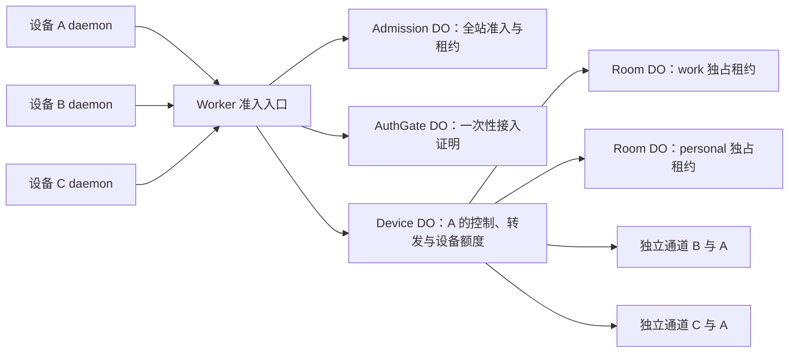

# 首版实施方案与验证门槛

方案日期：2026-10-09；实施状态更新：2026-10-10。#1–17 的工程实现及受控验证已有记录，#18 已产出四平台 `0.1.0-dev` 候选包，完整发布验收仍有缺口。本文保留设计目标并注明实际实现；当前证据与发布阻塞见[候选验收记录](validation/2026-10-10-candidates.md)。

## 当前结论

Herdr 0.9.3 的独立 native client 连接已具备多客户端基础，但产品已按用户要求限制同实例同时一个活动 Relay 客户端；每次 attach 仍使用独立 socket、独立加密通道。见 [ADR-0012](adr/0012-single-active-client-per-target.md)。Cloudflare 端到端连接、休眠后恢复和租约续期已完成受控实测。证据见[兼容性报告](herdr-compatibility.md)、[协议](../protocol/README.md)、[端点加密决定](adr/0011-endpoint-tls-and-pairing.md)及[休眠记录](validation/2026-10-10-hibernation.md)。

## 本机进程与状态

一个 OS 用户配置最多运行一个 Rust 发布 daemon，管理设备身份、已共享目标、邀请和入站授权。命令行作为本地管理入口；每个前台 `connect` 独立使用该配置的身份和出站授权，监督自己启动的原生 Herdr client，控制终端与退出行为。发布 daemon 停止会关闭它管理的通道，Herdr server 和 agent 继续运行。

| 状态 | 保存位置与生命周期 |
|---|---|
| 设备私钥与证书 | 用户私有目录，跨 CLI / daemon 重启保存 |
| 目标定义 | `target_id`、显示名称、明确的 session/socket 定位方式、enabled 状态；跨 Herdr 进程重启保存 |
| 方向授权 | `(publisher, peer, relay_origin)`、公钥固定、授权版本、撤销状态；由发布方本地数据库决定 |
| 邀请与兑换结果 | 带过期和消费状态；配对落盘事务后才返回成功 |
| 运行代次、通道、TLS 和流控窗口 | 短期状态；断线丢弃，不能重用为重连状态 |
| 前台终端与 native client PID | 当前 `connect` 所有，不能依据进程名杀其他客户端 |

本地管理 socket 仅用户本人可访问；所有管理输入仍需校验。当前有界配对状态使用单个 JSON 快照：独立文件锁串行化修改、完整快照 fsync、原子替换和目录 fsync，使邀请消费与授权成为同一笔事务。身份文件独立原子写入；未来状态迁移前须备份，不能将多个文件写入当成一笔事务。服务重复启动通过本地锁和 socket 所有权拒绝，不能生成第二份身份接管第一份。

共享目标在配置中保存 session 的逻辑定位方式；每次连接按固定版本规则解析，验证 socket 类型、所有者和所属目录，拒绝不明确的路径或意外符号链接。轮询仅用于发现可用性，真实 attach 失败才是连接结果；路径存在不等于 Herdr 在线。探测不得自动启动 server。

## Cloudflare 职责分配

图中的箭头只表示路由关系。每个数据通道有两条由端点主动建立的 WSS；DO 使用入站 Hibernation WebSocket，不主动连接用户主机。

- **Worker**：先取得全站入口租约，再读取有界请求、验证设备接入证明和分派。候选云环境限制测试设备；正式默认 origin 尚未公开。
- **Admission / AuthGate DO**：前者以稳定单对象协调全站请求、发布者、通道及每日预付服务时间；后者保管并一次性消费接入 nonce。
- **Device DO**：一个发布设备的在线控制连接、方向授权镜像、邀请路由、目标注册及跨目标的通道额度预留。设备私钥、秘密和本地路径不上传。
- **Room DO**：一个逻辑目标的独占 attach 租约；Device DO 负责消费角色 ticket、校验帧和窗口、成对转发及恢复休眠状态。
- **Rust 发布端**：最终决定授权、目标可用性和是否接入 Herdr。即使云端镜像过期，也不能绕过本机撤销。

当前实现将 WebSocket 路由保留在 DeviceRelay，独占占用委派给 Room DO；每次转发检查持久化租约期限，30 秒聚合续期更新 120 秒租约。#11–12 已验证目标级限流和休眠恢复；#17 增加全站租约。实际协议与记录见 [access-v1](../protocol/access-v1.md)、[远端验收](validation/2026-10-10-remote-native.md)和[全站准入](validation/2026-10-10-admission.md)。

Room DO 与主机 daemon 均检查单实例占用；同一 session 不允许重复注册为不同目标绕过限制，主机按实际实例归一化检查。占用绑定预留 ID、channel ID 和运行代次，旧清理事件不能释放新占用。Device DO 的持久化预留配合有期限的 Room 租约；释放、超时和失败补偿幂等处理。Device DO 到期后拒绝旧通道数据，Room 以租约到期和精确 owner/reservation 判断是否可重新发放占用。租约续期采用低频聚合，不逐数据包调用另一个 DO。实际周期及受控空闲费用输入已记录在候选验收中。

Hibernation 要求每次唤醒恢复路由、offset、限流和窗口；不能依赖构造器之前的 Map。attachment 只放有界连接元数据，不放终端内容。应用循环计时器和待完成工作可能影响休眠，因此使用端点 ping、事件驱动检查和必要的低频维护；“用了 Hibernation API”不等于已经达到空闲费用目标。[Cloudflare WebSocket 指南](https://developers.cloudflare.com/durable-objects/best-practices/websockets/)

## CLI 契约

以下入口已实现，详细参数以候选二进制的 `--help` 和 README 为准。

| 操作 | 当前命令 | 行为 |
|---|---|---|
| 前台服务 | `herdr-relay serve --relay --origin URL` | 单用户 daemon，前台日志，Ctrl-C 停止服务 |
| 用户服务 | `herdr-relay service install/start/stop/status/uninstall` | 子命令分别执行；安装保留身份，状态说明未登录限制 |
| 发布目标 | `herdr-relay share add --session work --name work` | 明确解析 session，生成 target ID，不启动 Herdr |
| 目标管理 | `herdr-relay share list/enable/disable/remove` | 停用保持配置；remove 删除共享定义并关闭该目标通道 |
| 生成邀请 | `herdr-relay pair create` | 输出一次性串、访问范围和有效期，可撤销邀请 |
| 导入邀请 | `herdr-relay pair accept` | 从无回显交互输入或 stdin 读取，不在 argv 带秘密 |
| 管理设备 | `herdr-relay devices --origin URL`、`peers list/revoke --origin URL` | 方向授权独立；撤销只影响入站授权 |
| 查看目标 | `herdr-relay targets --origin URL --host <id>` | 经加密控制通道读取对方已共享目标及在线状态 |
| 连接 | `herdr-relay connect --origin URL --host <id> --target <id>` | 显式指定发布设备和目标；缺少必填参数时拒绝启动 |
| 服务配置 | `herdr-relay relay switch --from OLD --to NEW` | 停止 daemon 后显式重置配对域、保留身份和目标；重装用户服务时指定新 origin |
| 运营状态 | `herdr-relay relay status --origin URL` | 仅 operator allowlist 内设备可读取签名聚合状态 |

`share add` 对不存在的 session 报错；已保存目标以后离线时保留共享定义。邀请生成和兑换都需要发布方 daemon，但可以没有任何在线 Herdr 实例。每个本地配置使用一个 Relay origin；切换 origin 后重新配对，保留目标定义，不自动把旧 origin 的授权迁移给新服务。

后台服务启动不能依赖 shell profile、相对路径或临时目录；更新使用稳定二进制路径并保留数据。`service stop` 保留 enabled 配置供用户再次启动恢复；`share disable` 持久禁用，不会被重启自动取消。

## 连接、恢复与撤销

| 事件 | 本机动作 | 自动恢复边界 |
|---|---|---|
| 网络断开 | 关闭旧通道和本地 native socket，丢弃队列；监督原生 client 退出、恢复终端 | 旧占用确认释放后，退避建立新通道；另一连接已占用则报忙结束，不抢占 |
| 用户主动退出 native client | 结束这次 `connect`，释放 reservation | 不自动拉起用户刚退出的界面 |
| 目标 Herdr 退出 | 全部相关旧通道结束，目标标为离线 | 只监测该已配置 session；出现新实例后生成新 runtime ID |
| daemon 重启 | 加载持久配置及撤销状态，生成新 boot ID，重建控制连接 | 启用目标自动重新发布；客户端各自重新 attach |
| 停止共享 | 先持久化 disabled，再拒绝新连接并关闭该目标全部通道 | 必须显式 enable 后才恢复 |
| 撤销设备 | 先持久化撤销和版本，再关该 peer 在本机所有目标上的通道，同步云端 | 反向独立授权、其他 peer 和目标定义不变 |

等待重连时 CLI 只接受取消，不收集稍后转发的输入。重新交还 TTY 前清理本次连接遗留的终端输入；无法安全区分时丢弃并提示，不能将等待期间键盘内容补发。需要分别验证正常退出和网络失败，不能仅凭 native client 的非零退出码决定无限重启。

不提供输入“恰好执行一次”的承诺：断线前最后的输入可能已经执行，但客户端不知道；新连接依靠 Herdr 当前状态恢复画面，不重放未知结果的按键。

撤销可保证本机停止后续接入和转发，不能收回已经写入 Herdr 的输入，也不能撤回已经送达对端的数据。建议验收目标为本地撤销提交后 1 秒内关闭本机受影响 socket，Relay 正常可达时 5 秒内同步关闭相关云端路由；这是待测试目标，不是已达成 SLA。

## 初始限额与超时

除每实例一个活动 attach 是**已确认的产品约束**外，下列值用于原型和压测，属于工程建议，不是公开服务承诺。自建可调整资源参数，但不能提高单实例活动 attach 上限，也不能取消帧和队列硬限制。

| 项目 | 原型默认值 | 执行位置 |
|---|---|---|
| 每设备共享目标 | 8（工程建议） | daemon、Device DO |
| 每实例活动 attach | 1（产品约束；待建立占用也排他） | 主机 daemon、Room DO |
| 每发布设备跨目标 attach 总数 | 8（自建可降为 1–8） | Device DO 持久化预留 + daemon |
| 每设备已授权 peer / 同时待兑换邀请 | 64 / 4 | 发布端本地事务；达到上限明确拒绝 |
| 每设备未完成内层认证的通道 | 4 | daemon、Device DO；另限制入口 IP 速率 |
| 每发布设备短期 pair/control 通道 | 合计 4，空闲 30 秒关闭 | daemon、Device DO；认证前后都计数，和 attach 额度分开 |
| 数据块 / 控制消息 | 16 KiB / 8 KiB | Rust 与 TS 在分配前校验 |
| 每方向信用窗口 | 64 KiB（压测实现值） | 发送方、接收方及 Device DO |
| 每通道每方向额外明文/待发送队列 | 合计 64 KiB | Rust，TLS 内部缓冲另显式设限并计入总额 |
| daemon Relay 应用缓冲预算 | 16 MiB 总额，满时背压 | Rust；不包含 Herdr、自身固定开销或内核缓冲 |
| 每通道持续 DATA 字节速率 | 每方向 256 KiB/s，允许 512 KiB 短突发 | Rust + Device DO token bucket |
| 每目标总流量 | 两方向 DATA 合计至多 512 KiB/s | Device DO；每方向分别执行 256 KiB/s |
| 每目标总消息速率 | 两方向合计 300 条/s，短突发 600 条，含 CREDIT | Device DO；每方向分别限 150 条/s、突发 300 |
| 邀请 / ticket | 10 分钟 / 30 秒 | 本地事务 / DO；过期不可开新通道 |
| 内层握手 / 无进展慢端 | 10 秒 / 30 秒 | Rust 端；本地 Herdr hello 仍受 4 秒限制 |
| 网络探活 | 原生 ping 每 25 秒，75 秒未获 pong 判失联 | Rust；不能据此承诺 1 秒发现断网 |
| 自动重连 | 初始 1 秒，指数增长至 30 秒并加随机抖动 | `connect`；尊重限流并可 Ctrl-C 取消 |
| 离线目标监测 | 每 500 毫秒检查所配置路径元数据 | daemon；不创建 Herdr |

当前实现及测量见[流控验证](validation/2026-10-10-flow-control.md)。窗口从草案的 256 KiB 收紧到 64 KiB；8 个共享目标对应至多 8 条 attach，另有 4 条短期通道。总应用缓冲的 16 MiB 仍是验收预算，而非已实现的独立分配器硬上限；实现通过逐通道、窗口与连接数量上限限制分配，Herdr 与内核内存另测。

字节速率达到上限可短暂背压；持续超过消息速率或不能在有界缓冲内等待则关闭该通道。连接配额不足立即报错，不踢掉其他客户端。300 条/s 是原型应用限额，不是平台性能保证；小包、控制消息和多对象共享运行时仍需实测。

Cloudflare 当前文档列出入站 WebSocket 消息最多 32 MiB、单 DO 约 1000 请求/s 的软限制；本方案采用更小应用帧和目标级额度。它们不能证明实际吞吐，尤其不能将 Herdr 的 32 MiB 图形帧加封装后作为一条平台消息。[平台限制](https://developers.cloudflare.com/durable-objects/platform/limits/)

## 公开免费服务的运营边界

按设备限额无法防止批量生成新身份。现已实现入口 IP 分钟额度、未认证请求池、全站租约及准入开关，并提供容量指标与告警阈值。生产告警接收人和预算通知尚未配置。IP 限制考虑共享出口；被限流时返回可识别错误和重试提示，不引入账号注册。

全站总额度由 SQLite Admission DO 统一协调，按日预付服务时间不等同于实际流量或账单。工程保留期和限额演练见[运维说明](operations.md)。生产保留期、运营预算和告警接收人仍待 #19 指定。预算告警不是精确扣费硬上限，也不能把所有失败请求费用消除。

Cloudflare 免费套餐提供 SQLite DO，超出免费额度后相关操作会失败；入站 WebSocket 消息按官方规则折算请求，持续活动还可能产生 duration 与存储费用。因此“对用户免费”不能推导为“运营者永远零成本”。费用估算应使用实际连接时长、活动时间、消息数、RPC 和存储读写，并计入 Worker 等其他项目。[计费文档](https://developers.cloudflare.com/durable-objects/platform/pricing/)

默认不记录终端内容、明文 payload、邀请秘密、接入 token 或私钥。诊断日志只含错误码、经处理的路由标识和资源指标；IP 防滥用数据单独设置短保留期。具体保留天数属于发布配置，不在本轮捏造承诺。

## 平台与服务矩阵

| 目标 | 二进制目标建议 | 后台方式 | 当前证据 |
|---|---|---|---|
| macOS Apple Silicon | `aarch64-apple-darwin` | 每用户 LaunchAgent | macOS 27 原生客户端、完整服务生命周期及故障恢复；GUI 画面验收未完成 |
| macOS Intel | `x86_64-apple-darwin` | 每用户 LaunchAgent | macOS 27 / Rosetta 客户端和服务生命周期；未测物理 Intel Mac |
| Linux x86_64 | `x86_64-unknown-linux-musl` | systemd user；无 systemd 时前台/外部 supervisor | Ubuntu 24.04.4 / x86_64 内核 6.8.0-117 / QEMU，双向原生连接与服务生命周期 |
| Linux arm64 | `aarch64-unknown-linux-musl` | 同上 | Ubuntu 24.04.4 / arm64 内核 6.8.0-117 / VZ，同上 |

macOS 用户 LaunchAgent 与登录会话相关，首版不能把它描述成开机未登录也可访问的系统 daemon。[Apple 文档](https://developer.apple.com/library/archive/documentation/MacOSX/Conceptual/BPSystemStartup/Chapters/CreatingLaunchdJobs.html)

Linux 用户服务退出登录后的驻留需要按目标发行版核验 linger / logind 设置；安装器应检查并说明，不默认修改系统权限策略。无用户服务管理器时明确提供前台模式；“支持 Linux”不代表每个发行版都存在 systemd。

最低 macOS 版本、Linux 内核/发行版和终端组合由 CI 与实机结果确定。建议至少验证当前受支持 Ubuntu LTS 与一个 musl 用户空间，但最终矩阵尚未锁定。上游发布目标只证明存在构建资产，不是本项目的兼容性结论。[Herdr release workflow](https://github.com/herdrdev/herdr/blob/7b116c05bfda646af39d2524c54e70c751f57ee8/.github/workflows/release.yml)

## 分阶段交付与退出条件

| 阶段 | 输出 | 必须通过 |
|---|---|---|
| P0 本机适配 | Rust 本地 socket 桥接、目标定位、client 监督器 | 两个真实 TUI、双实例、输入与几何、显式 session 重启、退出不杀 server、无离线输入重放；当前 Python 探针仅是前置证据 |
| P1 设备信任与协议 | 内层 TLS、配对原子事务、授权存储、外层 codec 与共同 fixtures | ADR-0011 的安全负例；Rust/TS 字节一致；错误版本明确失败 |
| P2 受控 Cloudflare 联通 | Worker、Device/Room DO、独立 WSS、信用窗口、额度预留 | 同实例竞争仅一个成功；休眠后保留独占与路由；网络/daemon/Herdr 重启；不同目标一慢一快；撤销竞争；队列与上游 Herdr 内存观测 |
| P3 四平台与自建 | 发布包、用户服务、迁移升级、Cloudflare 部署说明 | 四目标实机或等效 CI 验证，跨 OS/架构连接；普通用户从空配置完成自建核心流程 |
| P4 默认公开服务 | 域名、运营预算、许可证、监控与准入配置 | 功能验收和限额演练全部通过；度量活动/空闲成本；发布渠道与恢复手册可用 |

P0–P3 的工程实现、受控 Cloudflare 部署和四平台候选构建已完成；这不等于所有验收门槛均已通过。P4 尚未发布。GUI 验收、全链路资源上限证据及 #19 发布决定仍是公开上线门槛；详见候选验收记录。

建议采样指标包括输入到画面 p50/p95、持续输出吞吐、Rust/Herdr RSS、最大队列、断线检测与恢复时间、撤销生效时间、DO 活动与休眠情况、每小时消息/RPC/存储开销。先记录局域和跨地区基线，再确定可承诺的性能阈值；不要把未经测量的数字写成验收已通过。

当前剩余的外部决定集中在许可证、默认域名与运营预算、最低平台版本和发布渠道。其余是上述 P0–P3 的工程验证工作，无需重复询问已经确认的产品范围。
