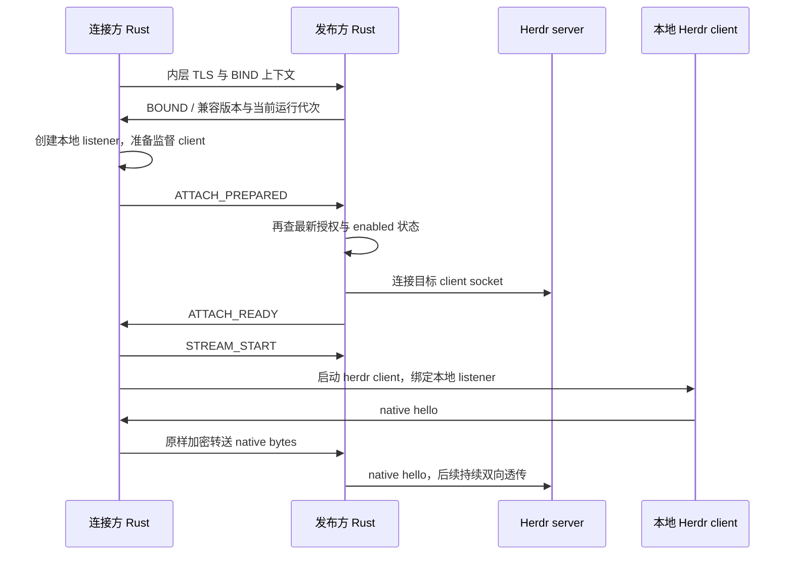

# Relay 协议 v1 草案

日期：2026-10-09。状态：**用于实现原型的设计草案，尚未冻结 wire compatibility**。产品约束来自 [GitHub Issues](https://github.com/hackerchai/herdr-relay/issues)，端点认证方案见 [device identity and TLS](../README.md#device-identity-and-local-encrypted-diagnostic)。签名消息编码、证书 profile 和跨语言样例必须在 P1 完成后才能发布协议 v1。

## 三层边界

| 层 | 解析者 | 内容 |
|---|---|---|
| 外层 WSS / Relay 控制 | Rust、Worker、DO | 设备接入证明、路由、角色、代次、窗口和错误；WSS 验证 Relay 域名 |
| 内层 TLS 1.3 / 端点控制 | 两个 Rust 端点 | 设备公钥认证、配对秘密、共享名称与列表、目标校验、attach 准备状态 |
| Herdr 原生字节流 | Herdr client / server | native 协议原样传送；Worker/DO 不解密，Rust 数据泵不重编 Herdr frame |

Relay 可以知道设备间的路由关系、opaque 目标 ID、连接时间、消息尺寸及流量。终端内容、配对兑换秘密、用户为目标取的名称和 session 路径只在端点保存或内层传送。

## 身份和生命周期字段

| 字段 | 含义与约束 |
|---|---|
| `device_id` | 身份公钥指纹；不能只凭显示名称认证 |
| `target_id` | 发布方创建的随机稳定 ID，映射到明确保存的逻辑 session；不接受任意远程路径 |
| `boot_id` | 发布方 daemon 每次启动产生的随机代次；旧 daemon 的 ticket 不得接入新 daemon |
| `runtime_id` | 发布方观察到目标重新接入/替换时产生的运行代次；不使用 PID 单独作为身份 |
| `channel_id` | 每次连接生成的 128 bit 随机 ID；正常访问、配对控制都使用新 ID |
| `grant_version` | 发布方本地每条方向授权的持久化单调版本；撤销和重新授权不能重用旧版本 |
| `purpose` | `pair`、`control`、`attach` 三选一；配对通道不能升级成操作通道 |
| `role` | 相对于目标的 `publisher` 或 `connector`；与设备本身类别无关 |

同一设备可为不同目标打开多个 `channel_id`，同一实例同时只允许一个 attach 占用（含待建立和活动状态）。另一个 attach 即使来自同一设备且使用新 ID，也返回 `TARGET_BUSY`；不会替换正常通道。一个 ID 的任一角色被占用后，再接入应报 `CHANNEL_CONFLICT`，不得踢掉旧连接。网络恢复也不重用旧 ID。

## 云端准入与通道开通

1. 设备向 Relay 申请短期挑战，使用身份私钥签名，证明公钥持有。签名必须绑定 Relay origin、协议版本、操作、随机 nonce、有效期和必要请求字段；挑战只能消费一次。接入 token 有期限和设备作用域，不构成 Herdr 授权。
2. 发布方在其 Device DO 上建立控制 WSS，注册 boot ID、opaque 共享目标和授权镜像。共享名称由内层控制通道提供；云端镜像不能替代发布方本地授权。
3. 连接方通过 Device DO 请求配对或已授权控制通道。配对需有效的未过期邀请路由 ID，仍受速率与未认证连接上限约束；兑换秘密只在内层提交。普通控制请求检查方向授权镜像，发布方再次校验。
4. 连接方经内层控制通道请求目标 attach。发布方核对授权、目标启用状态和已知运行状态后，由主机与 Room DO 分别原子预留该实例的唯一 attach 占用，并在 Device DO 预留设备总连接额度；部分成功须补偿，不得因跨 DO 操作超售。重复目标配置与别名须归一化或拒绝，不能为同一实际实例建立多个独占槽位。
5. Relay 为两个角色分别发放一次性短期 ticket，绑定 origin、双方设备、目的、目标、boot/runtime/grant 代次、channel ID、角色、reservation ID 和截止时间。兑换还必须与当前设备接入证明匹配，不能仅凭 ticket 充当另一端。
6. 两端分别主动建立入站 WSS，Room DO 消费各自 ticket。只有两端到齐才发送 `ROUTE_READY`；未到齐不排队 Herdr 数据。预留失败、超时和关闭按预留 ID、channel ID 与运行代次幂等释放；先确认旧数据通道停止或使其代次失效，再释放独占占用和额度。迟到清理不得释放后续连接；跨 DO 中途失败不得泄漏或超售配额。休眠恢复必须保留唯一占用，不能仅凭租约到期假设旧连接已停止。
7. 两端建立内层 TLS，比较加密上下文，然后按下节完成 native attach。所有安全检查通过前不向本地 Herdr 写入任何字节。

云端处理步骤是提案；挑战/ticket 的规范编码、签名 domain separator、过期边界、跨 DO 预留补偿必须有确定性样例与故障测试后冻结。不能用对任意 JSON 字符串签名代替规范定义。

发布方常驻控制 WSS 仅用于在线注册和开通通知。`pair` / `control` 的端点 TLS 各自使用新的双端 WSS，由 Device DO 配对路由，遵循同样的一次性角色 ticket、窗口和生命周期规则；不在常驻控制流内混入 native 字节。它们使用独立的短期控制通道额度，不占用某个 Herdr 目标，因此 Herdr 离线仍可配对。普通 `control` 完成目标查询或开通后及时关闭，空闲超时不自动重放请求。

## native attach 与字节流切换

内层控制消息使用 `u32` 大端长度加 UTF-8 JSON，单条至多 8 KiB。schema 必须拒绝重复键、非法字段类型和当前状态不允许的消息。`purpose=attach` 的流程为：

`STREAM_START` 后同一内层连接只承载原生字节，不再插入 JSON、错误文本或重连消息。实现必须保留同一次 TLS read 中控制消息后已经到达的字节，不能因切换解析器而丢包。后续结束通过关闭通道报告。

Herdr 的本地 hello 必须在其 4 秒限制内完成；网络和 TLS 提前建立只能减少风险，仍须实测启动时间和网络 RTT。超时丢弃整个通道，不能继续旧握手。控制用 `purpose=control` 通道不切换成 native 流。

## 外层数据帧

每条二进制 WebSocket 消息只含一个 Relay frame。默认密文块不超过 **16 KiB**；TLS record 和 Herdr frame 都可以跨多个块，Relay 不等待完整上层 frame。外层固定头为 32 byte，整数均大端：

| 字节偏移 | 字段 | 大小 |
|---|---|---|
| 0 | 协议 major，草案值 `1` | 1 |
| 1 | kind：`1=DATA`，`2=CREDIT` | 1 |
| 2 | flags，首版必须为零 | 2 |
| 4 | channel ID 原始字节 | 16 |
| 20 | offset，方向内累计密文字节数 | 8 |
| 28 | payload length | 4 |
| 32 | DATA 密文；CREDIT 为空 | 0–16384 |

DATA 的 offset 必须恰好等于该方向下一预期位置；长度必须与实际 payload 相符。CREDIT 的 offset 表示对向流已接收并释放缓冲预算的位置，只能单调增加、不能超过已发送位置；它不代表 Herdr 已执行输入。JSON 中如需表示 64 bit 计数，使用十进制字符串，避免 JavaScript Number 精度丢失。

未知 major、kind、非零 flags、越界长度、错 channel、重复/跳跃 offset 或伪造 CREDIT 均关闭该通道。不要尝试重排或重放。首版不支持半关闭：一端结束意味着整个通道结束。

## 有界流控与休眠恢复

- 每方向初始窗口建议 256 KiB；始终满足 `sent - consumed <= window`。握手阶段同样计入窗口，并额外限制握手总量与时间。
- 接收端只有在密文已被 TLS 处理、对应明文已交给下游或占用明确的有界缓冲后才能前移 CREDIT。窗口不能仅因为调用了 WebSocket `send()` 就恢复。
- CREDIT 不受 DATA 窗口阻塞，避免双方等窗口死锁；合并发送并单独限频。对足够小的低速流也应及时回 credit，不能一直等待固定批量阈值。
- Rust 同时限制读入、TLS、明文、待发送以及 daemon 总缓冲；耗尽预算即暂停上游读取。持续无法取得进展时关闭慢通道。目标进程中的 Herdr 队列另需验证，见[Herdr compatibility patch](../patches/herdr/README.md)。
- Room DO 不保留应用数据队列：已配对则检查窗口并转发，未配对则拒绝。接收端信用、帧尺寸、消息速率与连接配额共同限制平台发送缓冲的压力；真实平台队列仍需压测。
- 使用 `acceptWebSocket`，由 attachment 保存绑定身份、角色、channel ID、代次、offset、窗口和限速状态；发送前先记账。休眠唤醒后从连接重建路由，缺失/冲突时保守关闭，不重放数据。
- 票据消费、预留和撤销版本需要可持久恢复；不能只放 attachment，因为连接关闭会失去 attachment。恢复出来的额度不应凭内存归零。
- 心跳由 Rust 端发原生 WebSocket ping；DO 不为每条连接设循环定时器或发起出站 WebSocket。休眠只保证可恢复状态，不能替代断网重连。

Cloudflare 官方说明入站 Hibernation WebSocket 可保留连接，但重置内存；原生 ping 可自动应答。设计因此区分连接 attachment 与持久授权/额度状态。[平台说明](https://developers.cloudflare.com/durable-objects/best-practices/websockets/)

## 失败与重试

控制阶段使用结构化错误 `{code, retryable, retry_after_ms?}`，长度受控制消息上限约束；数据阶段发送外层关闭原因并结束 native socket，不能将错误文本写入 Herdr 流。

| code | 客户端行为 |
|---|---|
| `HOST_OFFLINE` / `TARGET_OFFLINE` / `NETWORK_LOST` | 显示状态，自动退避重连，可取消 |
| `RELAY_BUSY` / `RATE_LIMITED` | 按有上限的服务端建议退避，不能紧循环 |
| `NOT_AUTHORIZED` / `REVOKED` / `SHARE_DISABLED` | 结束当前连接，需用户修正授权或共享状态 |
| `IDENTITY_MISMATCH` / `PROTOCOL_ERROR` / `INCOMPATIBLE_HERDR` | 明确失败，不降级；自动重试不能绕过错误 |
| `PAIR_INVALID` / `PAIR_EXPIRED` / `PAIR_USED` | 不建立新授权；仅符合规则的幂等重试可取回原结果 |
| `TARGET_BUSY` | 新连接显示“实例已被占用”并结束，不抢占或排队；自动重连仅可有限等待自身旧通道清理，发现其他占用即结束 |
| `QUOTA_EXCEEDED` / `CHANNEL_CONFLICT` | 说明作用域，不接管已有连接 |
| `SLOW_CONSUMER` | 关闭该连接，提示原因；若自动重试需退避并限制连续失败 |

重连一律重新校验授权、建立 TLS 和 native client，offset 从零开始；不会恢复旧窗口、旧输入队列或输入执行回执。未知结果的按键不自动重放。用户主动退出或取消时停止重试。

## 冻结协议前的样例和测试

Rust 与 TypeScript 必须共享有效和无效 frame fixtures，覆盖空载荷、16384-byte 边界、超过 JS 安全整数的 offset、计数溢出、重复/跳跃、错代次、断半包、畸形控制消息与 CREDIT 超前；只有 DATA/CREDIT 外壳由两端共同解释。

另需跨语言验证接入签名和 ticket 编码；执行两端串线、休眠恢复、同实例并发竞争仅一个成功、旧代次不能释放新占用、不同目标一慢一快、配额预留中途失败和撤销竞争测试。当前文件是规格草案，仓库尚无 Rust/TS 编解码实现或这些协议 fixtures。
