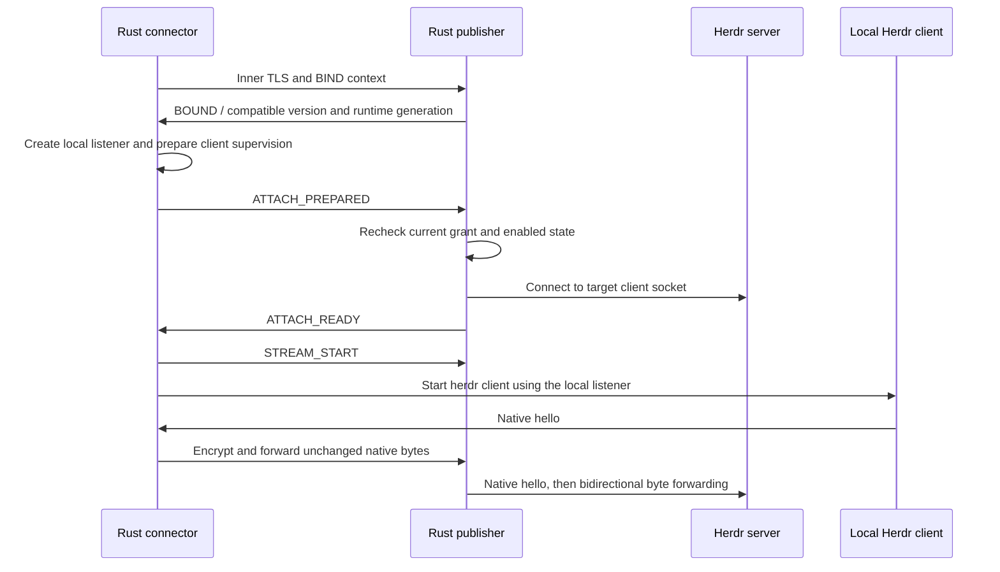

# Relay protocol v1 design draft

Original draft: 2026-10-09. This document records the proposed protocol and its
invariants; it does not declare frozen wire compatibility. For implemented
admission messages and routing, see [access-v1.md](access-v1.md). Shared signature
and frame examples are in [fixtures/](fixtures/). Product requirements are tracked
in [GitHub Issues](https://github.com/hackerchai/herdr-relay/issues).

## Protocol layers

| Layer | Interpreted by | Contents |
| --- | --- | --- |
| Outer WSS and Relay control | Rust endpoints, Worker and Durable Objects | Device admission proofs, routing, roles, generations, windows and errors; WSS validates the Relay hostname |
| Inner TLS 1.3 and endpoint control | The two Rust endpoints | Device public-key authentication, pairing secrets, shared names and listings, target checks and attach preparation |
| Native Herdr byte stream | Herdr client and server | Unmodified native protocol; Worker/DO cannot decrypt it and the Rust data pump does not re-encode Herdr frames |

The Relay can observe routing relationships between devices, opaque target IDs,
connection times, message sizes and traffic volume. Terminal contents, pairing
redemption secrets, user-assigned target names and session paths remain at the
endpoints or travel inside the encrypted endpoint channel.

## Identity and lifecycle fields

| Field | Meaning and constraints |
| --- | --- |
| `device_id` | Identity public-key fingerprint; a display name is not authentication |
| `target_id` | Random stable publisher-assigned ID mapped to an explicitly saved logical session; arbitrary remote paths are rejected |
| `boot_id` | Random generation for each publisher daemon start; old daemon tickets cannot enter a new daemon |
| `runtime_id` | Runtime generation observed when a target reconnects or is replaced; a PID alone is not an identity |
| `channel_id` | Random 128-bit ID generated for every connection, including pairing and control |
| `grant_version` | Persisted, monotonically increasing version of each directional grant; revocation and reauthorization cannot reuse an old version |
| `purpose` | One of `pair`, `control` or `attach`; a pairing channel cannot become an operation channel |
| `role` | `publisher` or `connector` relative to the target, independent of the device's other roles |

A device can open different channels for different targets. Each instance permits
only one pending or active attach. Another attach returns `TARGET_BUSY`, even
from the same device with a new channel ID; it never replaces a healthy channel.
Reusing an occupied role for a channel returns `CHANNEL_CONFLICT` without evicting
the existing connection. Recovery also uses new channel IDs.

## Cloud admission and channel setup

1. A device requests a short-lived challenge and signs it with its identity key.
   The signature binds the Relay origin, protocol version, operation, random
   nonce, expiry and required request fields. A challenge can be consumed once.
   Admission credentials expire and are device-scoped; they do not authorize
   Herdr access.
2. The publisher opens a control WSS to its Device DO and registers its boot ID,
   opaque shared targets and mirrored grants. Shared names travel through inner
   control messages. Cloud mirrors never replace the publisher's local grants.
3. The connector requests a pairing or authorized control channel through the
   Device DO. Pairing requires a valid, unexpired invitation route ID and remains
   subject to rate and unauthenticated-connection limits. The redemption secret
   travels only inside TLS. Ordinary control requests check mirrored directional
   grants, which the publisher checks again.
4. The connector requests target attachment through inner control. The publisher
   checks the grant, target enabled state and known runtime. The host and Room DO
   each atomically reserve that instance's exclusive attach slot, while the
   Device DO reserves device-wide capacity. Partial success requires rollback;
   cross-DO operations must not oversubscribe capacity. Normalize or reject
   duplicate session definitions and aliases so they cannot create extra slots
   for the same instance.
5. The Relay issues separate single-use, short-lived tickets for the two roles.
   Tickets bind the origin, both devices, purpose, target, boot/runtime/grant
   generations, channel ID, role, reservation ID and deadline. Redemption must
   also match the current device's admission proof; a ticket alone cannot
   impersonate the other endpoint.
6. Both endpoints actively open WSS connections to the Relay, and the Room DO
   consumes their tickets. It sends `ROUTE_READY` only after both roles arrive;
   it queues no Herdr data while waiting. Reservation failure, timeout and close
   release resources idempotently by reservation ID, channel ID and generation.
   Stop or invalidate the old data channel before releasing its slot and quota.
   Late cleanup cannot release a newer connection, and partial cross-DO failures
   cannot leak or oversubscribe reservations. Hibernation recovery must preserve
   exclusivity; lease expiry alone does not prove an old connection has stopped.
7. The endpoints establish inner TLS, compare their encrypted channel contexts,
   and perform native attachment as described below. No bytes reach the local
   Herdr socket before all required checks pass.

This setup sequence is a design proposal. Canonical challenge/ticket encoding,
signature domain separation, expiry boundaries and reservation rollback require
deterministic fixtures and failure tests before freezing the protocol. Signing
arbitrary JSON strings is not a substitute for a canonical encoding.

The publisher's persistent control WSS carries only online registration and
channel notifications. Each `pair` or `control` exchange uses a fresh pair of WSS
connections routed by the Device DO, with the same ticket, window and lifecycle
rules. Native bytes never enter the persistent control stream. These short-lived
channels use separate capacity and do not occupy a Herdr target, so pairing can
succeed while Herdr is offline. Ordinary control channels close after listing or
setup; an idle timeout does not trigger automatic request replay.

## Native attachment and stream transition

Inner control messages use a big-endian `u32` length followed by UTF-8 JSON, with
at most 8 KiB per message. The schema must reject duplicate keys, invalid field
types and messages disallowed in the current state. An attach channel follows
this sequence:

After `STREAM_START`, the inner connection carries only native bytes. It must not
insert JSON, error text or reconnect messages. Preserve bytes following a control
message in the same TLS read when switching parsers. Subsequent failure closes
the channel.

Herdr's local hello must finish within its four-second limit. Establishing the
network and TLS first reduces risk but does not replace measuring startup time
and RTT. A timeout discards the entire channel; it cannot resume the old handshake.
A `purpose=control` channel never switches to the native stream.

## Outer data frames

Each binary WebSocket message contains exactly one Relay frame. A ciphertext
chunk is at most **16 KiB** by default. TLS records and Herdr frames may span
chunks; the Relay does not wait for a complete higher-level frame. The fixed
header is 32 bytes, with all integers encoded in big-endian order:

| Byte offset | Field | Size in bytes |
| --- | --- | --- |
| 0 | Protocol major version; draft value `1` | 1 |
| 1 | Kind: `1=DATA`, `2=CREDIT` | 1 |
| 2 | Flags; must be zero in the first version | 2 |
| 4 | Raw channel ID | 16 |
| 20 | Cumulative ciphertext offset for this direction | 8 |
| 28 | Payload length | 4 |
| 32 | DATA ciphertext; empty for CREDIT | 0–16384 |

A DATA offset must equal the next expected position in that direction, and its
length must match the payload. A CREDIT offset acknowledges the opposite stream's
received bytes whose buffer budget has been released. Credit is monotonic and
cannot exceed bytes sent; it does not acknowledge execution by Herdr. Represent
64-bit counters in JSON as decimal strings to avoid JavaScript Number precision
loss.

Unknown major versions or kinds, nonzero flags, invalid lengths, wrong channels,
duplicate/skipped offsets or forged credit close the channel. Do not reorder or
replay frames. The first version does not support half-close: either endpoint
ending the stream ends the entire channel.

## Bounded flow control and hibernation recovery

- The proposed initial window is 256 KiB per direction. Always enforce
  `sent - consumed <= window`. Handshake traffic also consumes window capacity
  and has separate total-size and time limits.
- Advance CREDIT only after TLS has processed the ciphertext and the plaintext
  has reached the downstream consumer or a separately bounded buffer. Calling
  WebSocket `send()` does not replenish credit.
- CREDIT is independent of the DATA window to prevent deadlock. Coalesce it and
  rate-limit it separately, but return credit promptly for small, slow streams
  instead of waiting indefinitely for a batch threshold.
- Rust bounds incoming, TLS, plaintext, outgoing and total daemon buffering.
  Exhausting a budget pauses upstream reads; persistent lack of progress closes
  the slow channel. Herdr's own queue needs a separate bound; see the
  [Herdr compatibility patch](../patches/herdr/README.md).
- A Room DO keeps no application data queue. It validates credit and forwards
  data for a paired channel, otherwise it rejects the data. Credit, frame sizes,
  message rates and connection quotas together limit pressure on platform
  buffering; actual platform queues still require load measurements.
- Use `acceptWebSocket` and socket attachments to retain bound identities, roles,
  channel IDs, generations, offsets, windows and rate state. Account for data
  before forwarding it. Reconstruct routes after waking; missing or conflicting
  state closes the channel without replay.
- Ticket consumption, reservations and revocation versions must survive recovery.
  Attachments alone are insufficient because closing a socket removes them.
  Recovery must not reset quotas merely because process memory was cleared.
- Rust endpoints send native WebSocket pings. DOs do not create per-connection
  timer loops or outgoing WebSockets. Hibernation provides recoverable state,
  not network reconnection.

Cloudflare's [WebSocket documentation](https://developers.cloudflare.com/durable-objects/best-practices/websockets/)
explains that incoming hibernating sockets can survive an in-memory reset and
native ping frames can receive automatic responses. Socket attachments and
persistent authorization/quota state therefore have distinct roles.

## Failure and retry behavior

Control failures use structured `{code, retryable, retry_after_ms?}` messages
within the control-size limit. Data failures send an outer close reason and close
the native socket; error text must never enter the Herdr stream.

| Code | Connector behavior |
| --- | --- |
| `HOST_OFFLINE` / `TARGET_OFFLINE` / `NETWORK_LOST` | Show status and reconnect with cancellable backoff |
| `RELAY_BUSY` / `RATE_LIMITED` | Honor a bounded server-suggested delay; never busy-loop |
| `NOT_AUTHORIZED` / `REVOKED` / `SHARE_DISABLED` | End the connection; the user must correct authorization or sharing state |
| `IDENTITY_MISMATCH` / `PROTOCOL_ERROR` / `INCOMPATIBLE_HERDR` | Fail explicitly without downgrade; retry cannot bypass the error |
| `PAIR_INVALID` / `PAIR_EXPIRED` / `PAIR_USED` | Create no new grant; only a permitted idempotent retry may retrieve the original result |
| `TARGET_BUSY` | Report the occupied instance and exit without preemption or queuing; recovery may wait briefly for its own old channel to close, but stops when another client occupies the slot |
| `QUOTA_EXCEEDED` / `CHANNEL_CONFLICT` | Explain the affected scope without taking over an existing connection |
| `SLOW_CONSUMER` | Close the channel and explain why; automatic retry needs backoff and a consecutive-failure limit |

Every reconnect revalidates authorization and creates new TLS and native-client
connections with offsets starting at zero. It restores no previous window, input
queue or execution receipt. Never automatically replay keystrokes with unknown
outcomes. Explicit user exit or cancellation stops retrying.

## Fixtures and validation before freezing the protocol

Rust and TypeScript must share valid and invalid frame fixtures covering empty
payloads, the 16384-byte boundary, offsets above JavaScript's safe-integer limit,
counter overflow, duplicate/skipped offsets, wrong generations, truncated frames,
malformed control messages and credit ahead of sent data. Both languages share
interpretation only of the DATA/CREDIT envelope, not Herdr's native protocol.

Admission signatures and ticket encoding also require cross-language validation.
Exercise crossed endpoint connections, hibernation recovery, concurrent attach
with exactly one winner, old-generation cleanup racing a newer reservation,
independent slow and fast targets, partial quota-reservation failure, and
revocation races.

This remains a design draft. The repository now includes implemented Rust and
TypeScript codecs and [shared fixtures](fixtures/); consult
[access-v1.md](access-v1.md) and the source for the actual encoded messages and
limits rather than treating every proposed detail here as the wire contract.
